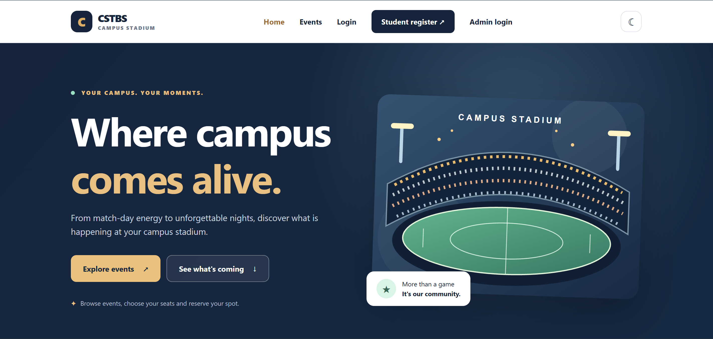
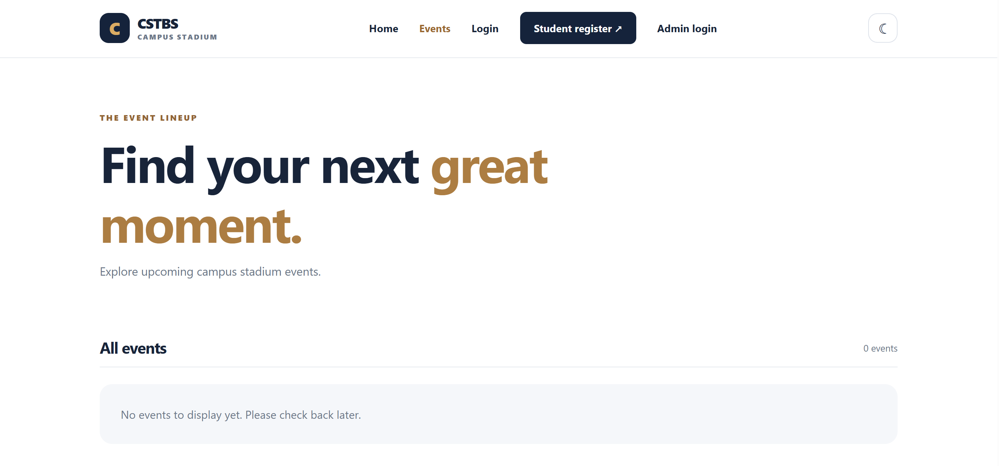
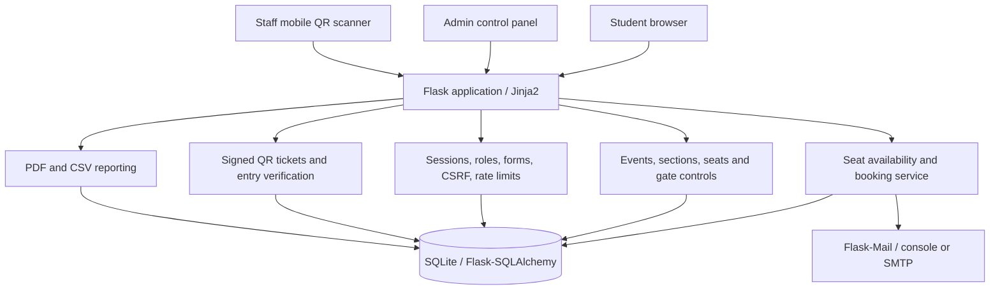
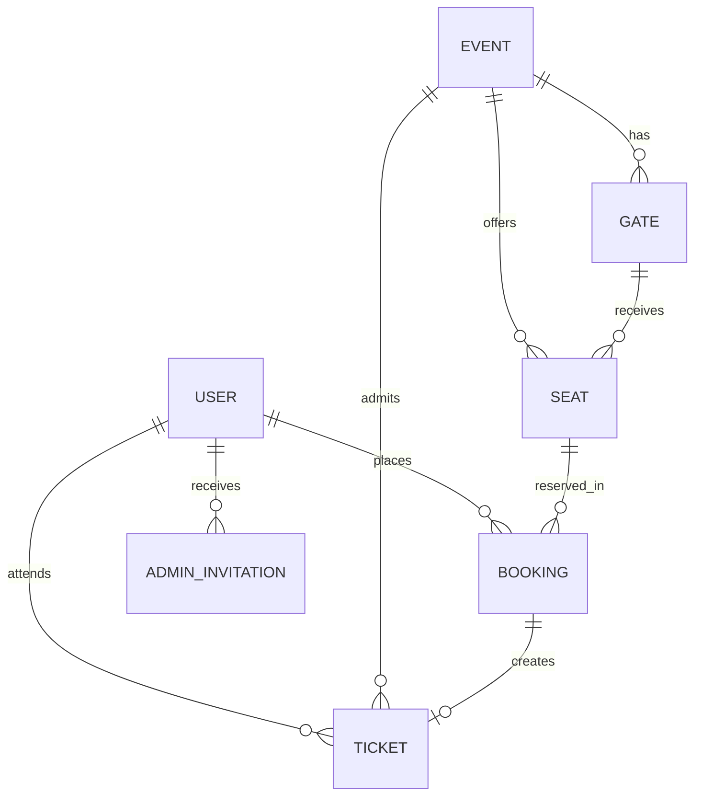

# Campus Stadium Ticket Booking System (CSTBS)

**This project has been developed by:**

| Developer | GitHub profile |
|---|---|
| **Monik Akter** | [@ItsMONIKAAKTER](https://github.com/ItsMONIKAAKTER) |
| **Meazbah Mehedi** | [@MeazbahMehedi](https://github.com/MeazbahMehedi) |

CSTBS is a Flask-based university stadium management platform. Registered students reserve **free** seats for campus events and receive individually signed QR tickets. Authorized stadium staff validate each QR at its assigned entrance; administrators manage events, sections, gates, user roles, reservations, check-ins and reports through a separate control panel. The interface is mobile-friendly and provides light/dark themes.

**Admission is free.** Monetary labels, where displayed for clarity, use RMB/CNY (**¥0.00**). There is **no payment gateway**.



## What the system includes

| User | Available functions |
|---|---|
| **Visitor** | Browse events and event details; see student registration and login. |
| **Student** | Register with a unique university Student ID; sign in; view student dashboard; select available seats; book for registered classmates; view individual QR tickets; review booking history; cancel unused reservations. |
| **Stadium staff** | Use the gate-scanning portal, choose an entrance, verify an attendee's ticket and student identity, and confirm check-in once. |
| **Administrator** | Manage events, booking windows, stadium gates, seating sections, blocked seats, accounts and roles, existing bookings, attendance, and PDF/CSV reports. |

### Account and admission rules

- Public student registration requires full name, email, **unique Student ID (6–20 alphanumeric characters)** and password. Student IDs are normalized, validated and stored uniquely.
- The **first administrator** is created from a local terminal prompt/CLI. A 20-minute one-time activation key appears in the terminal. The admin enters that key at `/admin/activate` and chooses a password. Later logins require **email + password only** at `/admin/login`. Nothing is pasted into Notepad or source code.
- Existing admins can invite/approve other admins through the admin UI. Role checks protect admin routes; students cannot self-promote.
- **One active ticket per student per event** is enforced in the database. A student may select more than one seat only when each extra seat is assigned to a **different, already registered student** whose name and Student ID match their account. The first seat must belong to the booking student.
- Availability is checked before confirmation, with SQLite constraints preventing conflicting active seat reservations. Cancelling a booking preserves its history and invalidates its admission ticket.
- Each attendee gets one signed QR ticket showing the event, date/time, venue, entrance gate, section, row, seat, name, Student ID and ticket status. A QR contains an opaque signed reference, **not the student’s personal details**.
- Only authorized staff/admin may check tickets in. Verification distinguishes **valid**, **entry not open**, **wrong gate**, **cancelled**, **invalid** and **already checked in**. Check-in requires a separate POST confirmation and cannot be repeated.

## System architecture

This is a server-rendered Flask web application. Jinja2 provides HTML pages; CSS and JavaScript add responsive seat maps, theme switching and QR camera controls. Flask-SQLAlchemy maps application objects to SQLite tables. The application factory configures authentication, authorization, CSRF, notifications, rate limits, security headers and database upgrades.



### Database relationships



| Entity | Responsibility |
|---|---|
| `User` | Identity, Student ID, password hash, role, admin activation state. |
| `Event` | Event description, venue/time, whether booking and stadium entry are enabled. |
| `Seat` | Per-event section, row, number, blocked state and assigned entrance gate. |
| `Gate` | Named entrance for an event and its open/closed state. |
| `Booking` | Owner of one reserved seat, status and retained cancellation history. |
| `Ticket` | Actual student attendee, signed QR nonce, check-in status/time/operator/gate. |
| `AdminInvitation` | Hashed, time-limited and one-use administrator activation/recovery keys. |

**Database integrity:** Partial unique indexes prevent multiple reserved bookings for the same seat and multiple live tickets for one student at one event. SQLite triggers reject reservations of blocked seats, invalid blocking updates and inconsistent gate assignment. Compatibility migrations preserve older accounts and bookings and back up on-disk SQLite before schema changes. Do **not** delete internal `migrations_*.py` modules merely because older upgrade names appear in their filenames.

### Main Python modules

| Module | Purpose |
|---|---|
| `app/__init__.py` | Flask application factory, extensions, security, health endpoint, CLI commands. |
| `app/models.py` | SQLAlchemy models, relationships and data constraints. |
| `app/routes.py` | Public pages, student accounts, admin activation/login, reservations and cancellation. |
| `app/admin.py` | Stadium operations, sections, gates, roles, bookings and entry controls. |
| `app/entry.py`, `app/ticketing.py`, `app/qr_decode.py` | QR issuance, photo decoding, verification and atomic admission. |
| `app/forms.py`, `app/authz.py` | Validated Flask-WTF forms and role requirements. |
| `app/reports.py`, `app/notifications.py` | Private PDF/CSV exports and booking email notifications. |
| `app/seed.py`, `app/seating.py` | Development example events and default stadium seats. |
| `app/backups.py`, `app/migrations*.py` | Non-destructive SQLite backups and compatibility upgrades. |
| `app/static/`, `app/templates/` | Responsive UI, accessible themes, seat maps and dashboard pages. |
| `tests/` | Flask integration, authorization, booking, QR, migration and reporting tests. |

## Technologies

Python (CI: 3.10, 3.11 and 3.12), Flask, Flask-Login, Flask-WTF, Flask-SQLAlchemy, SQLAlchemy, SQLite, Jinja2, python-dotenv, Werkzeug, Flask-Mail, Flask-Limiter, ReportLab, qrcode/Pillow, OpenCV QR-photo decoding, JavaScript and modern CSS. GitHub Actions tests every push and pull request; **there is no automatic deployment job**.

## Install and run on Windows (PowerShell)

Open PowerShell inside the extracted project folder. Use Python 3.12 to match one of the tested CI versions (or another Python interpreter supported by `requirements.txt`).

```powershell
py -3.12 -m venv .venv
.\.venv\Scripts\python.exe -m pip install --upgrade pip
.\.venv\Scripts\python.exe -m pip install -r requirements.txt
.\.venv\Scripts\python.exe -m flask --app run.py init-db
.\.venv\Scripts\python.exe -m flask --app run.py seed-events
.\.venv\Scripts\python.exe run.py
```

For systems using a different installed Python version, use `py -0p` to inspect the installed interpreters and replace `-3.12` appropriately. The local development server generates a persistent private secret automatically in ignored `instance/` if no explicit `.env` is configured. **Production must supply separate, strong, persistent secrets.**

On first interactive startup, if no admin exists, enter the admin email and name at the PowerShell prompts. The application prints the single-use admin activation key. Activate the account at <http://127.0.0.1:5000/admin/activate>, then use `/admin/login` with email/password in future sessions. Admin recovery is available with the local `admin-reset EMAIL` command; it invalidates the old password/session.

### macOS / Linux

```bash
python3 -m venv .venv
source .venv/bin/activate
python -m pip install -r requirements.txt
python -m flask --app run.py init-db
python -m flask --app run.py seed-events
python run.py
```

### Useful pages

| Page | Path |
|---|---|
| Event catalogue | `/events` |
| Student registration | `/register` |
| Student login | `/login` |
| Student dashboard | `/dashboard` |
| Booking history | `/bookings` |
| Administrator activation | `/admin/activate` |
| Administrator login | `/admin/login` |
| Stadium control center | `/admin/` |
| Manage events | `/admin/events` |
| Manage students and roles | `/admin/users` |
| Manage bookings | `/admin/bookings` |
| Reports and exports | `/admin/reports/` |
| QR scanner for staff | `/entry/scan` |
| Attendance overview | `/admin/check-ins` |
| Database health check | `/health` |

The administrator dashboard links to event-specific seat and gate management pages. Gate entry is **closed by default** until an authorized admin opens it for an event. Staff selecting a different gate cannot override a ticket's assigned entrance.

## Demo data and notifications

`seed-events` inserts four sample university events with seat inventories **only when the catalogue is empty**. For optional test accounts, set a private `DEMO_SEED_PASSWORD` of 12–128 characters (development only) and run `python -m flask --app run.py seed-demo`. Never publish or reuse demo credentials in a real university system.

Notifications use `MAIL_BACKEND=console` by default (email preview in the local server log). Real SMTP requires private server settings and testing. Booking transactions commit before notifications are sent, so an email failure does not cancel saved reservations.

## Testing and GitHub workflow

Install requirements, then run:

```powershell
.\.venv\Scripts\python.exe -m unittest discover -s tests -v
```

GitHub Actions runs the same integration suite for Python 3.10–3.12, compiles Python files and checks JavaScript syntax. **Do not disable CSRF, authorization, or failing tests just to make CI green.** The integration test helper prevents stale Flask-Login and Flask-WTF caches when older tests retain an application context across multiple requests. Migration tests close SQLite connections before Windows removes temporary files.

**Updating an existing Git repository:** Extract this cleaned project into a **new folder** or replace the tracked application files in your repository. Remove old release-history documents and any obsolete `tests/test_university_v51.py`; merely copying the new files over an older checkout does not delete old files, and `unittest discover` will continue to run them. Keep your `.git` directory, private `.env`, `instance/` database and keys safe. Review `git status` and `git diff --cached` before `git push`. GitHub is for source code, not your runtime database.

A push **does not** deploy the app or alter production data. Before deploying, require successful CI, database and secret backups, validated restore procedures and a staging test. See the short manuals in `docs/` and [security guidance](SECURITY.md).

## Deployment and limitations

SQLite suits university demos and modest single-server deployments but does not replace a concurrency-tested production database. Live phone scanning requires HTTPS or localhost for reliable browser camera permissions; an image upload and manual-code path are provided as alternatives. Production also requires a WSGI server, trusted hosts, secure cookies, stable QR signing keys, shared rate-limit storage, persistent data volumes, SMTP and an institutional privacy/security review. Automated tests and successful local development do **not** by themselves certify the app for live stadium admission.

## Repository and license

Project repository: <https://github.com/ItsMONIKAAKTER/CSTBS>

See `LICENSE` for the repository's license terms if that file is present in your checkout. Maintainers: **Monik Akter** and **Meazbah Mehedi**.

### Safe replacement helper for an existing Git checkout

If you already have CSTBS committed to GitHub, **extract the clean ZIP to a different folder** and run the preview command from that extracted folder:

```powershell
.\scripts\sync-to-repository.ps1 -RepoPath 'D:\CSTBS\New folder'
```

After confirming the intended target and taking a separate backup, run:

```powershell
.\scripts\sync-to-repository.ps1 -RepoPath 'D:\CSTBS\New folder' -Apply
```

This stops if the target Git checkout has uncommitted changes. It replaces `app/`, `tests/`, `docs/` and the CI workflow, removing stale historical test files such as `test_university_v51.py` and old release documents. It deliberately **preserves `.git/`, `.env`, `instance/` (your live SQLite database and secrets), `.venv/` and `LICENSE`**. Inspect `git diff` before committing. A Git push alone never deploys CSTBS.
