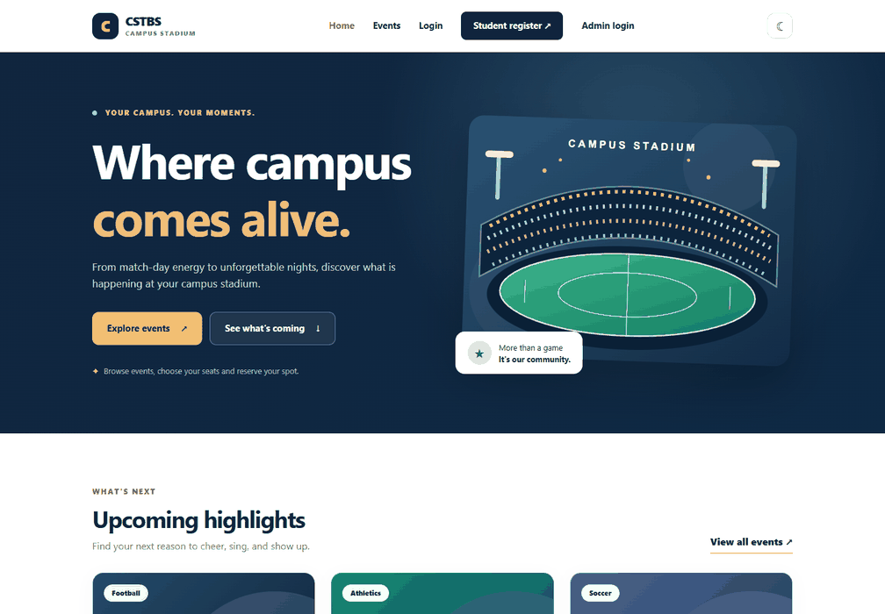
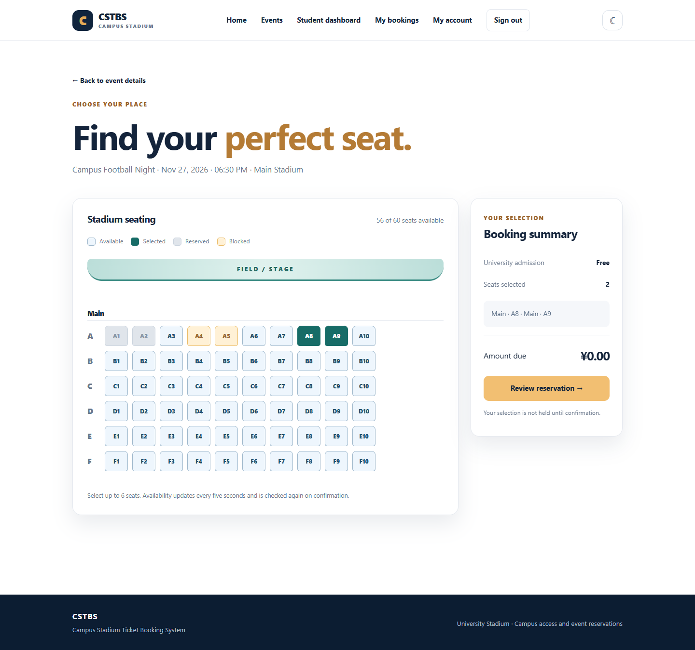
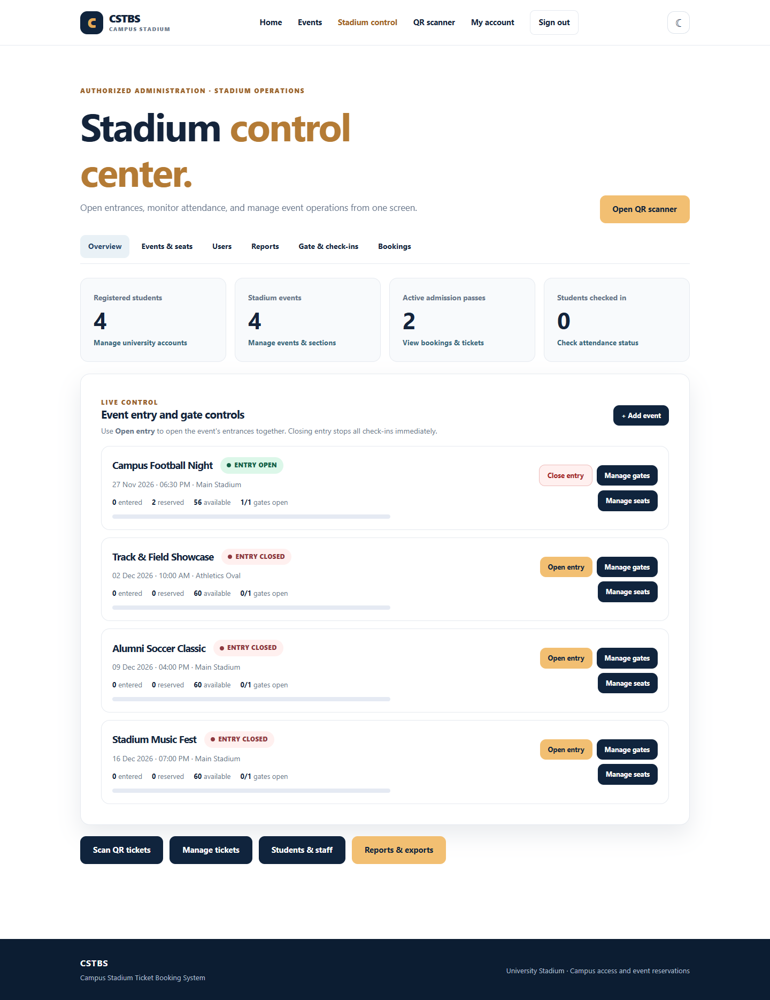

<div align="center">

# Campus Stadium Ticket Booking System

**Discover campus events. Choose your seats. Arrive with your QR pass.**

A university stadium booking application built with Flask, SQLAlchemy, and SQLite. CSTBS connects student reservations with staff admission checks and administrator gate operations.

[](https://github.com/ItsMONIKAAKTER/CSTBS/actions/workflows/tests.yml) [](https://www.python.org/) [](LICENSE)

[Get started](#get-started) · [Screenshots](#screenshots) · [Features](#features) · [Documentation](#documentation)



</div>

## Overview

CSTBS manages the journey from discovering an event to entering the stadium. Students reserve free assigned seats for themselves and registered classmates. Each attendee receives a signed QR admission pass, and authorized staff verify entry at the correct gate.

Administrators manage events, seating sections, bookings, accounts, attendance, and reports from a dedicated operations dashboard. Version 5.4 adds event-scoped gate assignments, individual entrance controls, and QR-photo scanning.

## Screenshots

The previews below were captured from the running application with fictional local demonstration data. The animated tour shows the application's interface and interactions.

| Seat selection | Stadium operations |
| --- | --- |
| [](docs/images/seat-selection.png) | [](docs/images/stadium-control.png) |

[View the homepage screenshot](docs/images/home.png)

## Features

| Area | Capabilities |
| --- | --- |
| Event discovery | Responsive event catalog, event details, animated interface, and day/night themes |
| Student accounts | Registration with a unique 6–20 character alphanumeric Student ID, password login, profile, and booking history |
| Reservations | Interactive seating map, five-second availability updates, up to six seats per checkout, and atomic booking confirmation |
| Classmate bookings | Registered attendee name and Student ID matching, with one live ticket per student per event |
| QR admission | Individually signed opaque QR tokens, private ticket images, gate selection, and one-use staff check-in |
| Camera and photos | Live scanning on compatible browsers plus QR-photo upload decoded on the application server |
| Stadium administration | Event and seat management, blocked seats, role management, section-to-gate assignments, and event or individual gate controls |
| Reporting | Attendance and booking views with access-controlled PDF and CSV exports |

All university reservations are free. The application displays a zero admission amount and processes reservations without a payment gateway.

## Reservation and admission flow

1. **Discover an event.** Browse upcoming activities and open the seating map after signing in.
2. **Select and review.** Choose up to six seats. The first seat belongs to the booker, and additional seats require matching registered classmates.
3. **Confirm the reservation.** CSTBS creates the bookings and individual tickets together, subject to seat and attendee availability.
4. **Open the admission pass.** Each student finds their personal QR ticket on the student dashboard, including tickets booked by classmates.
5. **Enter at the assigned gate.** An administrator opens entry. Staff select their physical gate, verify the attendee's university ID, and confirm check-in.

Repeated scans show the existing check-in status. Cancelled, unassigned, altered, and unknown tickets are rejected. Closed or incorrect gates produce a waiting message that explains the entry requirement.

## Get started

### Requirements

- Python 3.10 or newer
- Git and a modern web browser
- Node.js for the optional JavaScript syntax checks

SQLite is included with Python. Install the application dependencies from `requirements.txt`, which includes the QR generation and OpenCV photo-decoding packages.

### Windows PowerShell

```powershell
git clone https://github.com/ItsMONIKAAKTER/CSTBS.git
cd CSTBS
python -m venv .venv
.\.venv\Scripts\python -m pip install -r requirements.txt
.\.venv\Scripts\python -m flask --app run.py init-db
.\.venv\Scripts\python -m flask --app run.py seed-events
.\.venv\Scripts\python run.py
```

### macOS and Linux

```bash
git clone https://github.com/ItsMONIKAAKTER/CSTBS.git
cd CSTBS
python3 -m venv .venv
.venv/bin/python -m pip install -r requirements.txt
.venv/bin/python -m flask --app run.py init-db
.venv/bin/python -m flask --app run.py seed-events
.venv/bin/python run.py
```

Open **http://127.0.0.1:5000**. The event seed adds four sample events only when the catalog is empty.

### Administrator setup

On the first interactive local start, the terminal asks for the first administrator's email and name. It displays a single-use activation key that expires after 20 minutes.

1. Open `/admin/activate` and enter the administrator email, activation key, and a new 12–128 character password.
2. After activation, use `/admin/login` with the email and password.
3. For a pending administrator whose key expired, run `python -m flask --app run.py admin-key EMAIL` using the virtual environment's Python.
4. For deliberate recovery of an activated administrator, `admin-reset EMAIL` revokes the existing password and sessions and issues a recovery key.

A trusted operator can also run `python -m flask --app run.py admin-setup`. Administrator creation and recovery are managed through the local operator workflow. Public registration creates student accounts.

Development creates a persistent private secret in `instance/.local_secret_key` when an explicit `SECRET_KEY` is absent. Preserve that file when updating an existing local installation. Optional demo accounts can be created with `seed-demo` after supplying a private `DEMO_SEED_PASSWORD`. See the installation guide for details.

### Application routes

| Purpose | Route |
| --- | --- |
| Event catalog | `/events` |
| Student registration and login | `/register` and `/login` |
| Personal admission passes | `/dashboard` |
| Booking history | `/bookings` |
| Administrator login | `/admin/login` |
| Stadium operations | `/admin/` |
| Gate scanner | `/entry/scan` |
| Database health check | `/health` |

## Technology and structure

CSTBS uses Flask and Jinja templates for its server-rendered interface, SQLAlchemy for persistence, and standard JavaScript for seating, themes, and scanning. Flask-Login, Flask-WTF, and Flask-Limiter provide authentication, CSRF protection, and request limits.

```text
CSTBS/
├── app/
│   ├── templates/       # Public, student, staff, and administrator views
│   ├── static/          # Styles, JavaScript, and illustration assets
│   ├── models.py        # Users, events, seats, bookings, tickets, and gates
│   ├── routes.py        # Authentication, discovery, and reservations
│   ├── admin.py         # Stadium and account administration
│   ├── entry.py         # Ticket verification and check-in
│   └── reports.py       # PDF and CSV reporting
├── docs/                # Manuals, deployment notes, UML, and screenshots
├── tests/               # Integration and regression tests
├── config.py            # Environment-based configuration
├── run.py               # Local server and WSGI entry point
└── requirements.txt     # Application dependencies
```

## Security and operational behavior

- Passwords are hashed. Role authorization protects administration, staff scanning, and private ticket access.
- State-changing forms require CSRF tokens. Administrator activation and recovery keys expire and can be consumed once.
- Database constraints protect active seat reservations and live attendee tickets. Booking history, including cancellations, prevents event deletion.
- New events and migrated gates start closed. Administrators open entry and configure section assignments before staff admit attendees.
- QR tokens contain signed opaque references. Staff verify identity and use the CSTBS scanner to resolve the ticket.
- `.env`, databases, backups, signing keys, and runtime files are excluded from Git.

Live camera scanning requires HTTPS or localhost, browser permissions, and compatible camera-decoding support. The QR-photo fallback uploads an image to the application server for OpenCV decoding. Event times follow the campus/server configuration and require a consistent deployment timezone.

Production configuration requires stable secrets, HTTPS-only cookies, trusted hosts, shared rate-limit storage, and SMTP. See the deployment guide for persistent storage, backup, migration, and hosting requirements. Security reporting instructions are in [SECURITY.md](SECURITY.md).

## Testing

Run these commands with the virtual environment active, or use its Python executable directly.

```bash
python -m pip check
python -m unittest discover -s tests -v
python -m compileall -q app config.py run.py tests
node --check app/static/js/main.js
node --check app/static/js/seats.js
node --check app/static/js/scanner.js
```

GitHub Actions runs the integration suite and syntax checks on Python 3.10, 3.11, and 3.12 for pushes and pull requests. Tests cover authentication, CSRF, authorization, booking conflicts, cancellations, ticket signatures, gate entry, reports, and legacy SQLite upgrades.

## Updating an existing installation

Preserve the database and its secrets before upgrading. Stop the application, create a backup, and run `python -m flask --app run.py init-db` using the intended environment. The SQLite compatibility migrations apply schema updates and backfill gates and tickets while retaining booking history.

Legacy reservations with duplicate active attendees may require an administrator to assign additional tickets to verified classmates. Test the upgrade against a copy of the database and confirm existing QR passes, gate assignments, and reporting before reopening entry.

The [installation and deployment guide](docs/installation-deployment.md) covers V5.2/V5.3 upgrades, automatic pre-upgrade backups, recovery, and deployment configuration. GitHub CI verifies the source separately from the running stadium installation.

## Documentation

| Guide | Contents |
| --- | --- |
| [User manual](docs/user-manual.md) | Student accounts, classmate reservations, QR passes, and cancellations |
| [Administrator manual](docs/admin-manual.md) | Activation, stadium operations, roles, and attendee corrections |
| [Installation and deployment](docs/installation-deployment.md) | Local setup, production configuration, migrations, backups, and recovery |
| [Database design](docs/database-design.md) | Relationships, constraints, and compatibility |
| [UML diagrams](docs/uml.md) | Class, activity, and entry sequence diagrams |
| [Testing guide](docs/testing.md) | Release checks and operational acceptance scenarios |
| [Changelog](CHANGELOG.md) | Release history |

## Contributors

[MONIKA AKTER](https://github.com/ItsMONIKAAKTER) and [Md. Meazbah Mehedi](https://github.com/MeazbahMehedi).

Contributions are welcome through focused pull requests with a clear description and passing checks.

## License

Released under the [MIT License](LICENSE). Copyright © 2026 MONIKA AKTER & MEAZBAH MEHEDI.
