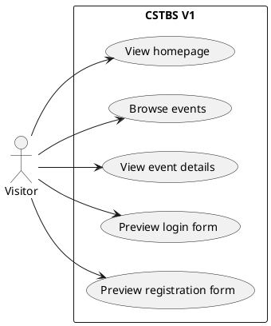
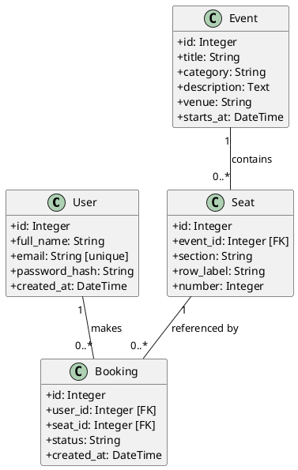
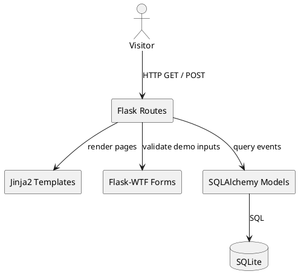
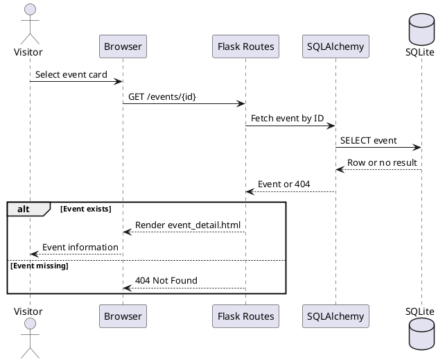

# CSTBS Version 1 — UML Diagrams

All diagrams below use [PlantUML](https://plantuml.com/) syntax. Paste the code into any PlantUML renderer to generate a diagram. Dashed interactions show **UI-only** behavior and do not imply real account or booking workflows.

## 1. Use case diagram

Visitor can browse event data and inspect prototype account forms. There is **no booking use case in V1**.

## 2. Class diagram (initial schema)

`Booking` belongs to a `User` and a `Seat`; the associated event is obtained through `Seat.event_id`. `Seat` is unique within an event by `(section, row_label, number)`.

## 3. Component diagram

The route/controller layer reads event records, renders Jinja2 templates, and validates prototype forms with Flask-WTF. SQLAlchemy is the persistence boundary.

## 4. Sequence diagram — browse event details

## 5. Future-facing boundary

The database includes `User`, `Seat`, and `Booking` to document the planned domain. The V1 HTTP interface intentionally **does not expose** registration persistence, authentication, seat reservation, cancellation, or checkout endpoints.
