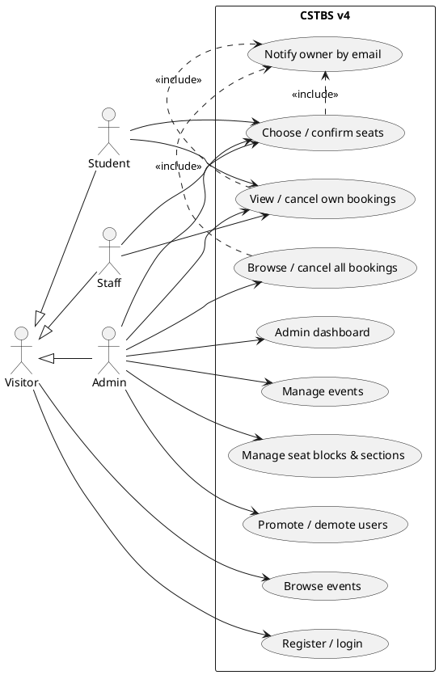
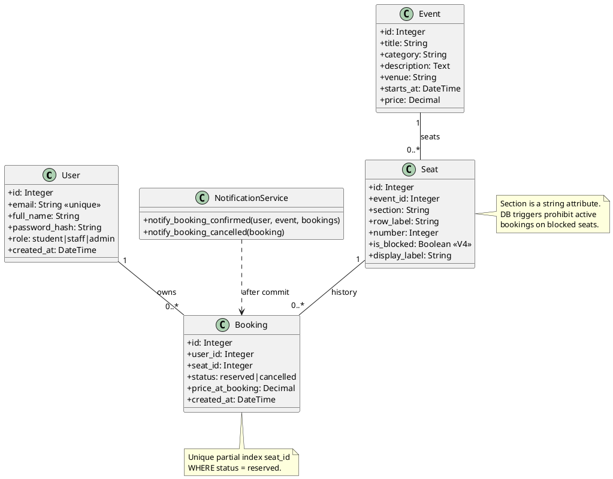
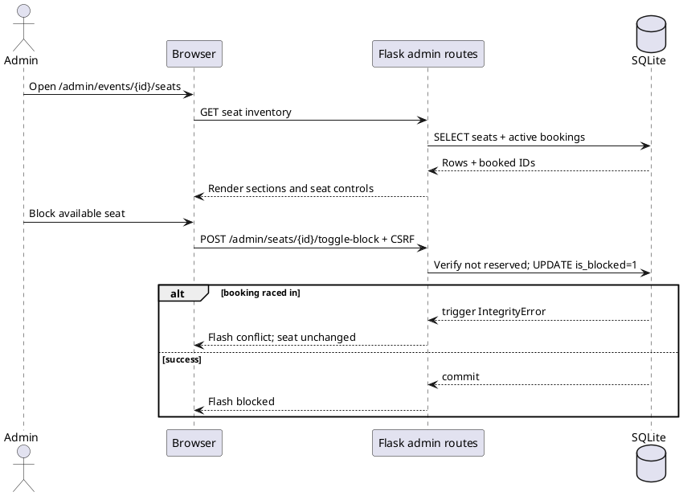
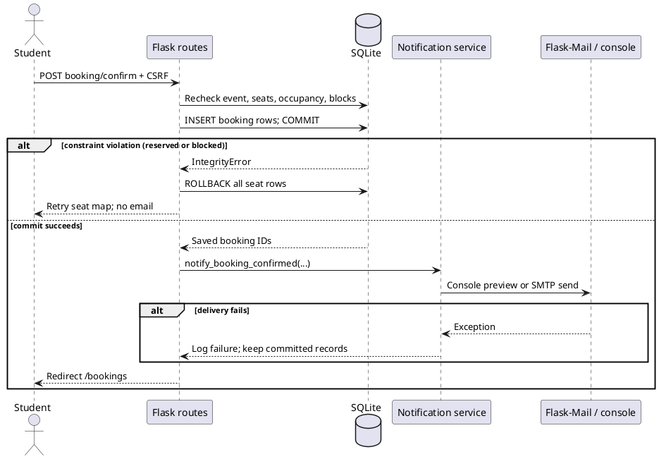
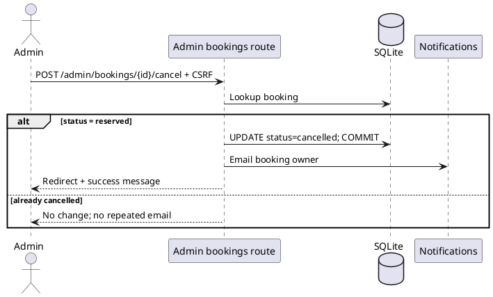
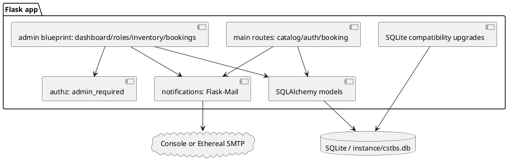

# CSTBS Version 4 — UML (PlantUML)

The following diagrams describe the implemented V4 architecture. Paste any code block into a PlantUML renderer.

## 1. Use-case diagram

## 2. Domain class diagram

## 3. Administrator seat/block sequence

## 4. Booking confirmation with email notification

## 5. Admin cancellation and owner notification

## 6. Components overview

