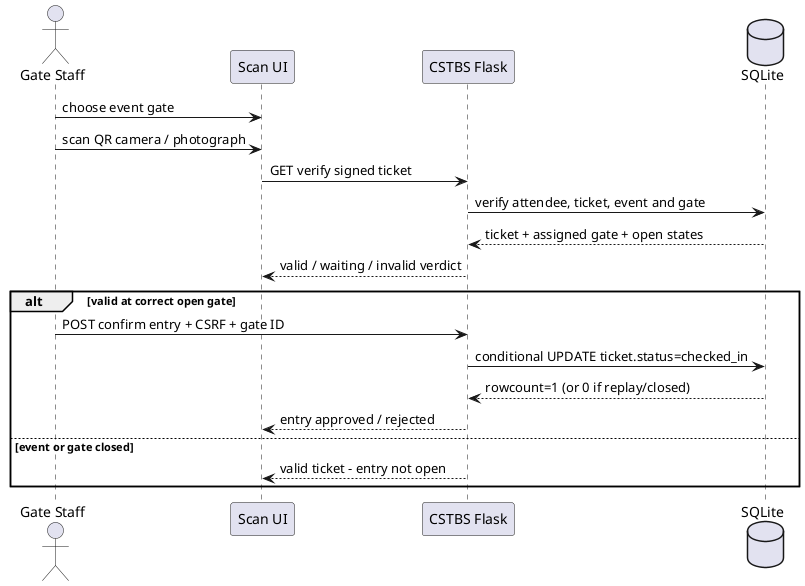
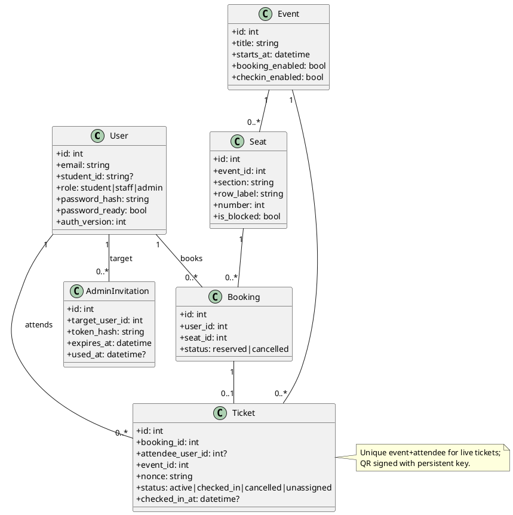
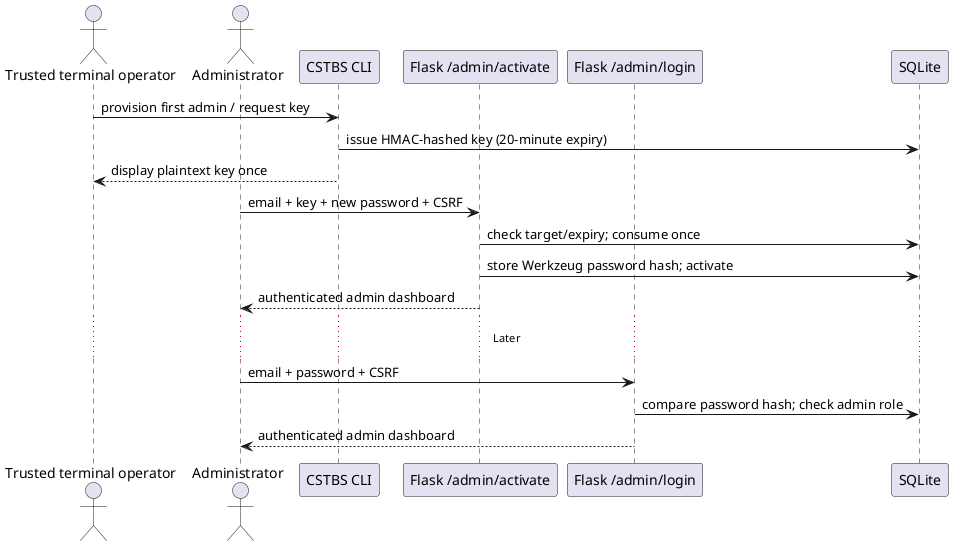
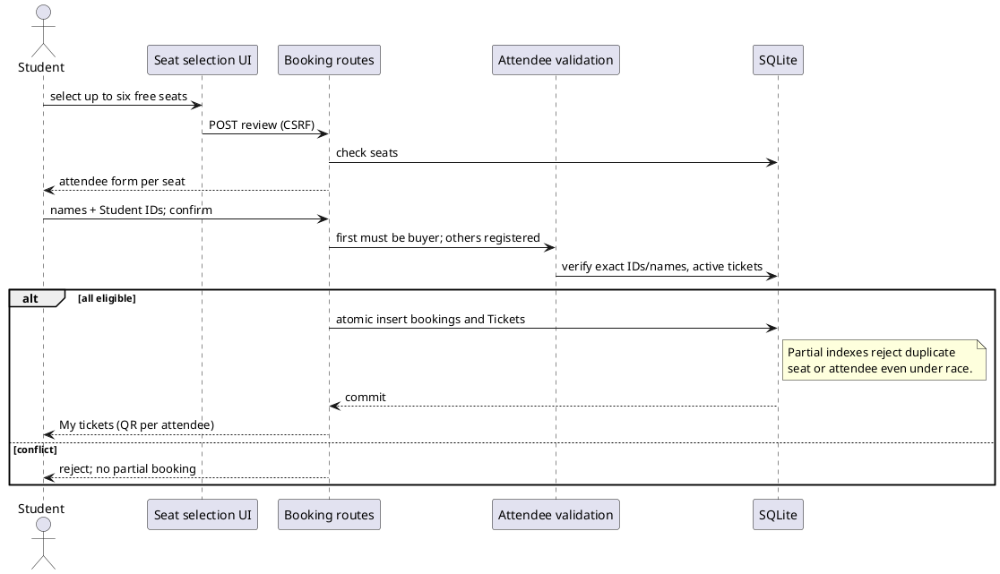
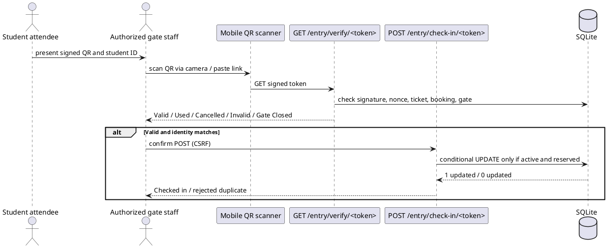
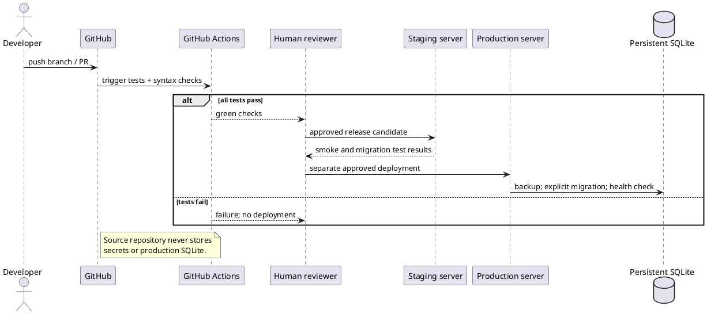

# V5.4 stadium gates and check-in (PlantUML)

```plantuml
@startuml
class Event { id : integer; checkin_enabled : bool }
class Gate { id : integer; event_id : integer; name : string; is_open : bool }
class Seat { id : integer; event_id : integer; gate_id : integer; section : string; row_label : string; number : integer }
class Booking { id : integer; status : reserved|cancelled }
class Ticket { id : integer; status : active|checked_in|cancelled|unassigned; checked_in_gate_id : integer? }
class User { id : integer; student_id : string?; role : student|staff|admin }
Event "1" -- "many" Gate
Event "1" -- "many" Seat
Gate "1" -- "many" Seat : entrance
Seat "1" -- "many" Booking
Booking "1" -- "0..1" Ticket
User "1" -- "many" Ticket : attendee
Gate "0..1" -- "many" Ticket : entry logged at
@enduml
```




# CSTBS v5.3 — UML (PlantUML)

Use any PlantUML renderer to preview these diagrams. Code blocks can be pasted directly into a `.puml` file.

## 1. Domain class diagram



## 2. First admin activation and later sign-in



## 3. Group reservation and duplicate prevention



## 4. QR verification and one-use stadium entry



## 5. Deployment and backup boundary


