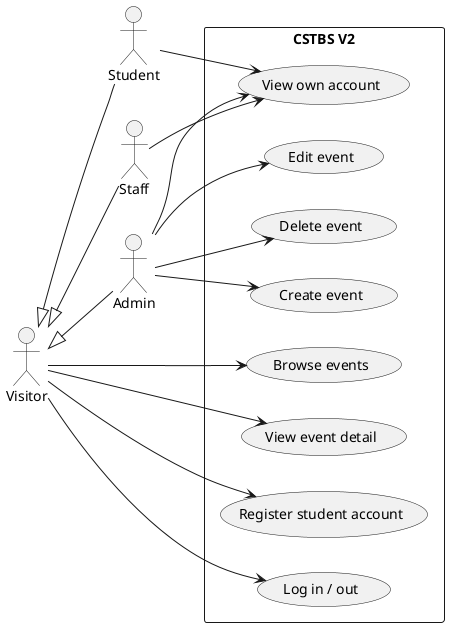
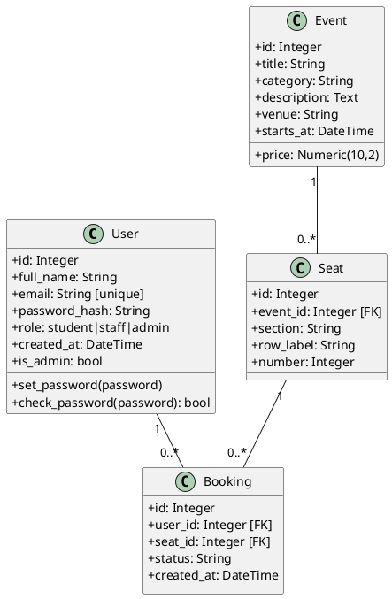
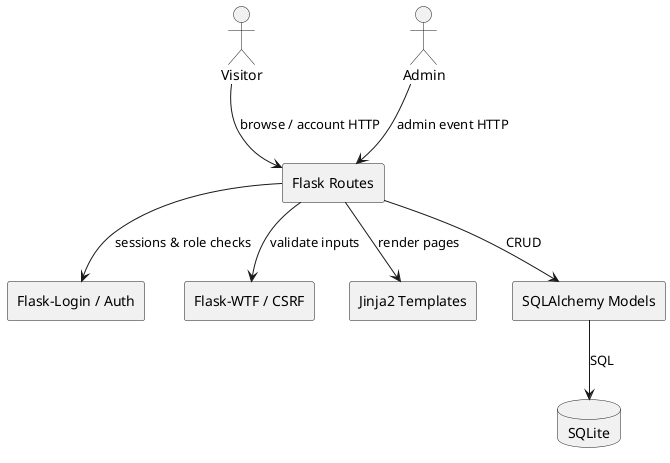
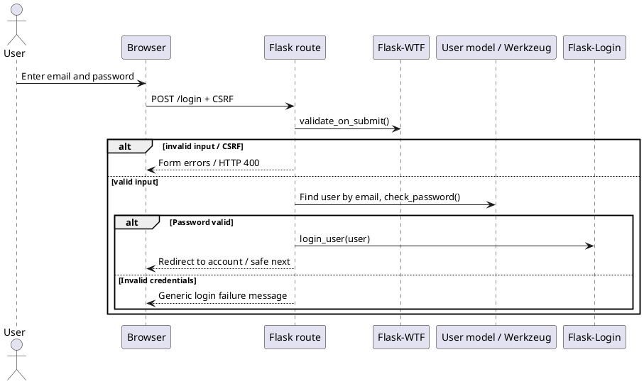
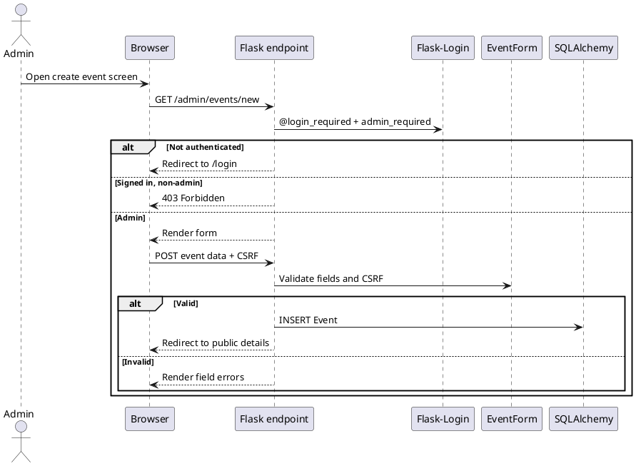

# CSTBS Version 2 — UML Diagrams (PlantUML)

Diagrams below document implemented **Accounts and Events** behavior. Seat and Booking remain schema-only until a later version.

## 1. Use cases

## 2. Class diagram

## 3. Component diagram

## 4. Sequence: user login

## 5. Sequence: administrator creates event

