# CSTBS v5.1 — University Registration UML

## Student and administrator registration use cases

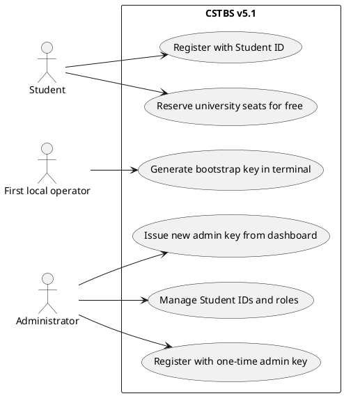

## Domain additions

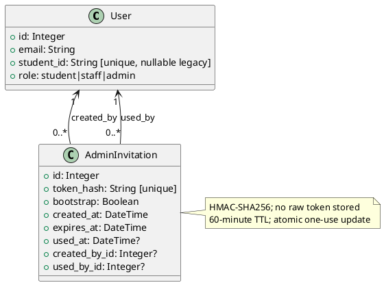

## Administrator invitation sequence

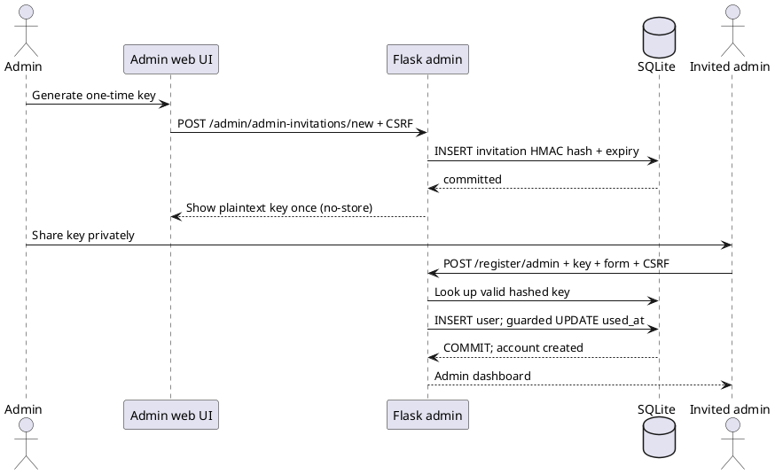

## Booking without payment

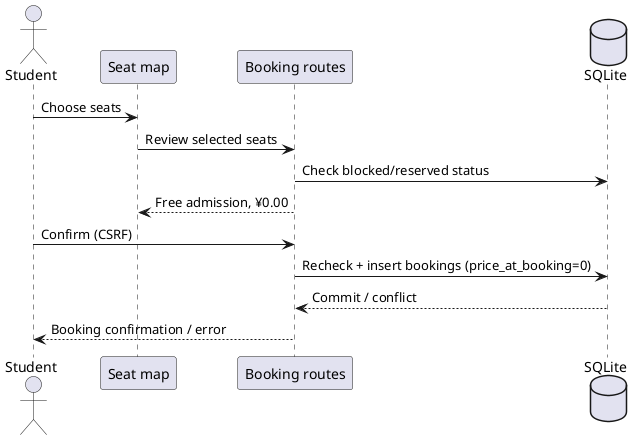

---

## V5 UML (historical context)

# CSTBS Version 5 — UML (PlantUML)

The original V4 diagrams are preserved below; V5 adds reporting and export sequence diagrams.

The following diagrams describe the implemented V4 architecture. Paste any code block into a PlantUML renderer.

## 1. Use-case diagram

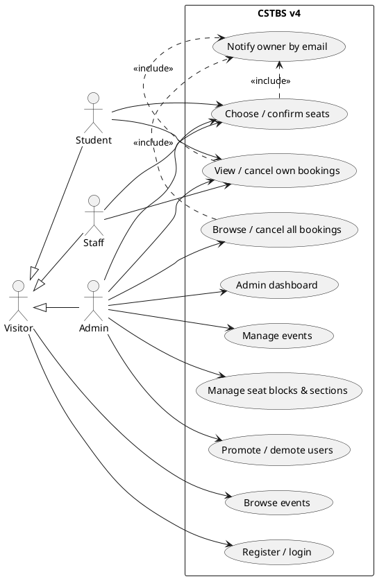

## 2. Domain class diagram

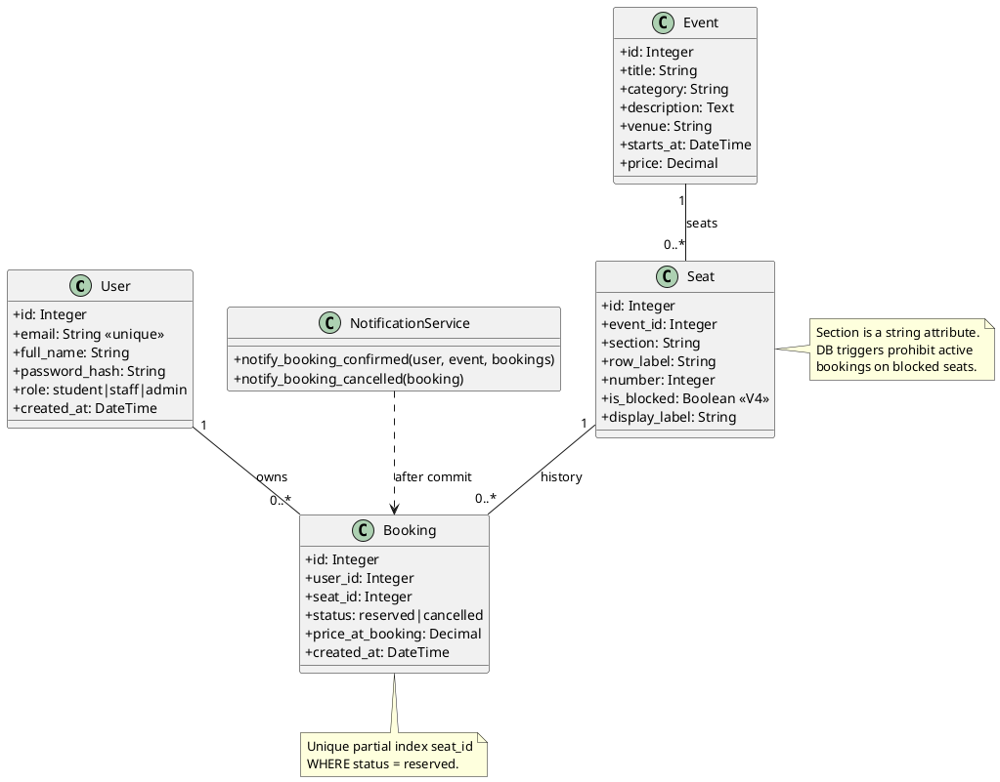

## 3. Administrator seat/block sequence

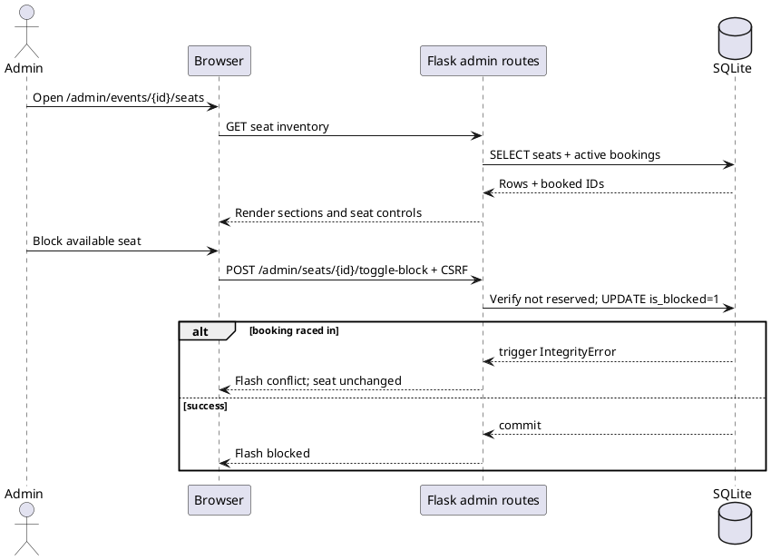

## 4. Booking confirmation with email notification

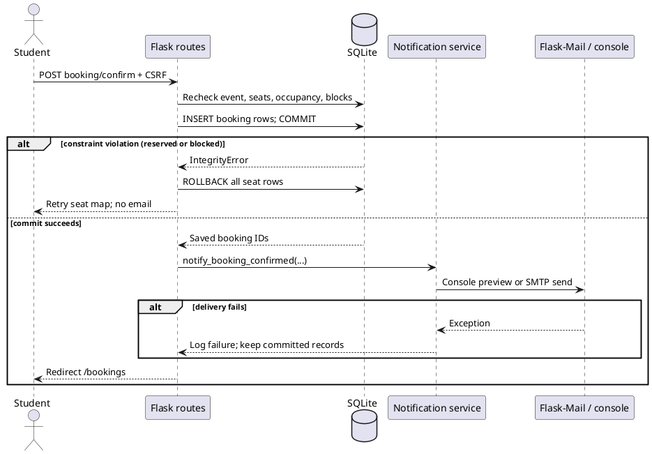

## 5. Admin cancellation and owner notification

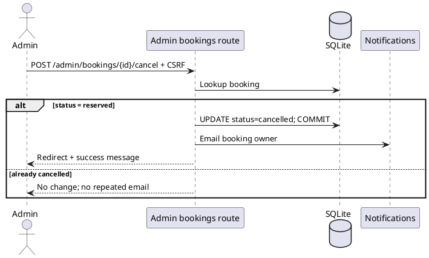

## 6. Components overview

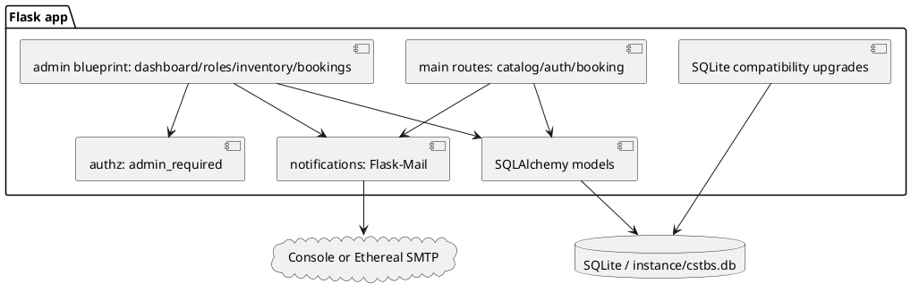

## 5. V5 reporting use case

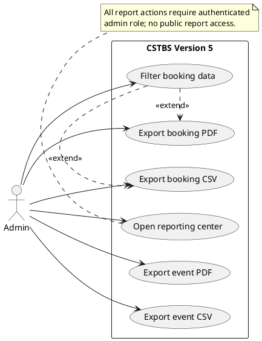

## 6. V5 report export sequence

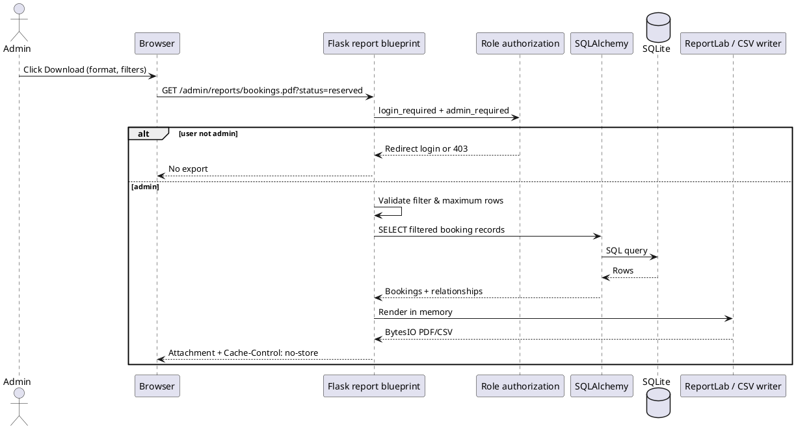

## 7. Component structure

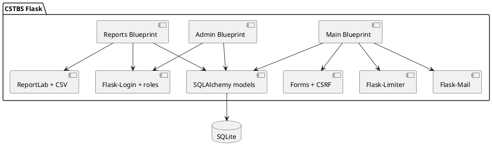
