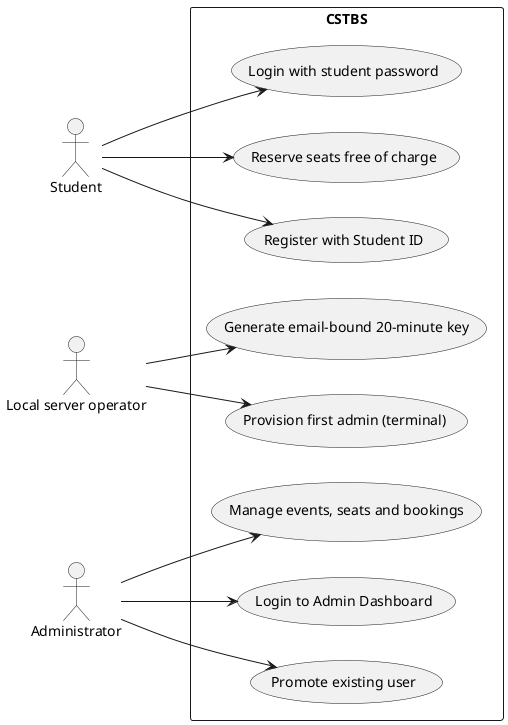
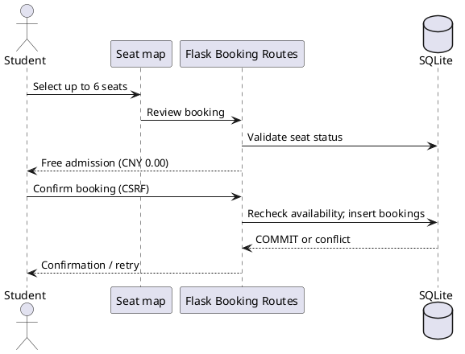

# CSTBS v5.2 — Access and Reservation UML (PlantUML)

## Administrator login use case



## Login sequence

```plantuml
@startuml
actor "Local operator" as Operator
participant "run.py / admin-key CLI" as CLI
participant "Flask /admin/login" as Flask
participant "Flask-Login" as Session
participant "SQLite" as DB
actor Admin
Operator -> CLI : Enter admin email in terminal
CLI -> DB : Verify existing admin and store token HMAC
with target_user_id and 20-minute expiry
CLI --> Operator : Print one-time key once
Admin -> Flask : POST email, key and CSRF token
Flask -> DB : Validate email + keyed hash + expiry + target admin
Flask -> DB : Atomic consume used_at (single use)
DB --> Flask : Commit
Flask -> Session : login_user(admin, fresh=True)
Flask --> Admin : Redirect /admin/
@enduml
```

## Domain relationships

```plantuml
@startuml
class User { id; email; student_id; password_hash; role }
class AdminInvitation { id; token_hash; target_user_id; expires_at; used_at }
class Event { id; title; starts_at; venue; price }
class Seat { id; event_id; section; row_label; number; is_blocked }
class Booking { id; user_id; seat_id; status; price_at_booking }
User "1" <-- "*" AdminInvitation : target
User "1" <-- "*" Booking : owner
Event "1" <-- "*" Seat
Seat "1" <-- "*" Booking
note bottom of AdminInvitation : 20-minute one-time token.
HMAC fingerprint only.
@enduml
```

## Free seat reservation


