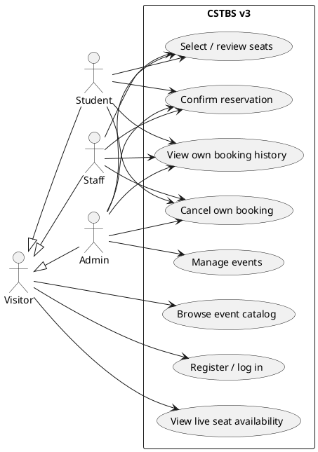
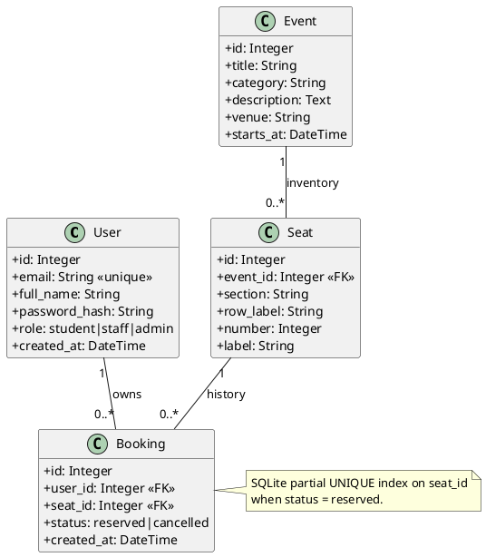
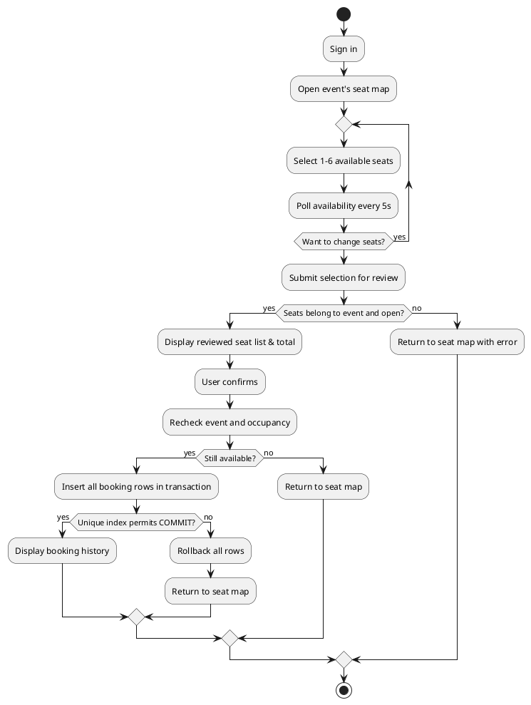
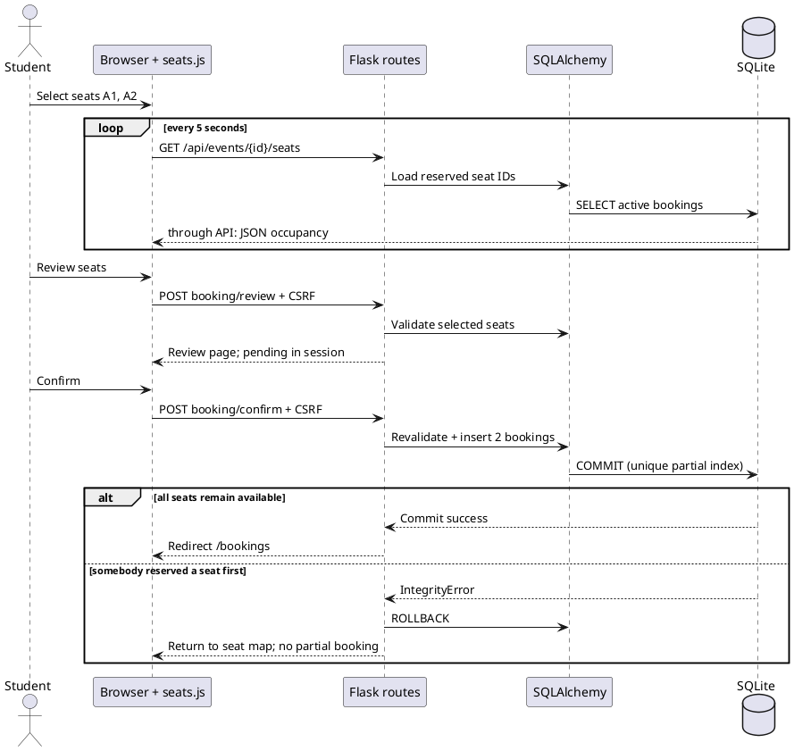
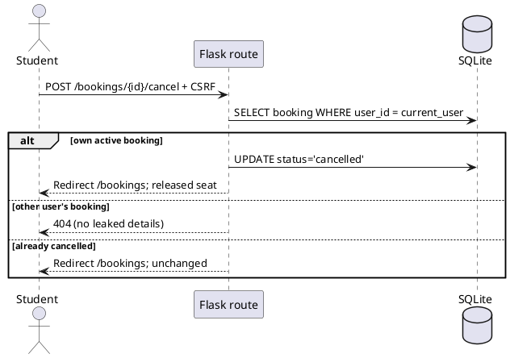

# CSTBS Version 3 — UML (PlantUML)

The following PlantUML source renders the main implemented V3 behavior; copy each block into any PlantUML viewer to generate diagrams.

## 1. Use-case diagram

## 2. Class/ER diagram

## 3. Booking activity diagram

## 4. Seat availability / confirmation sequence

## 5. Cancellation sequence

